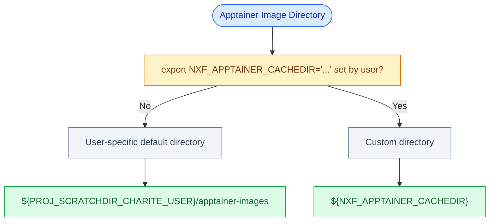
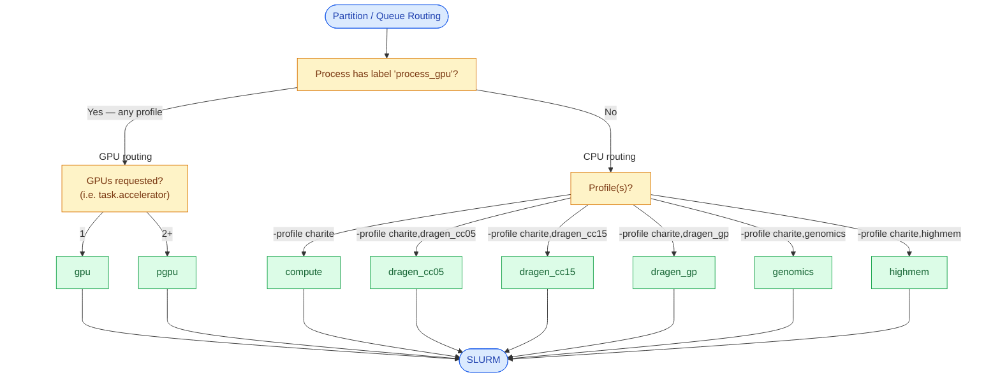

# nf-core/configs: Charité Configuration

This page documents the `charite` Nextflow profile for running Nextflow and nf-core pipelines on the Charité HPC. See the full configuration at [`conf/charite.config`](../conf/charite.config). For general HPC information, see [Charité Science IT](https://www.charite.de/en/research/research_support_services/research_infrastructure/science_it/).

> Official Contact: Scientific Computing, GB IT, Charité - sc-hpc-helpdesk@charite.de

## Table of Contents

- [Contributors and Acknowledgments](#contributors-and-acknowledgments)
- [Quick Overview and Usage Examples](#quick-overview-and-usage-examples)
- [Requesting Charité HPC Access](#requesting-hpc-access)
- [Environment Setup](#environment-setup)
  - [Redirecting Output to Project Scratch](#redirecting-output-to-project-scratch)
  - [Global Utility Variables](#global-utility-variables)
  - [Apptainer-specific Variables](#apptainer-specific-variables)
  - [Nextflow-specific Variables](#nextflow-specific-variables)
  - [Nextflow Strict Syntax](#nextflow-strict-syntax)
  - [Nextflow Conda Environment](#nextflow-conda-environment)
- [Running Nextflow Workflows on the Charité HPC](#running-nextflow-workflows-on-the-charité-hpc)
  - [Option 1: Interactive Session](#option-1-interactive-session)
  - [Option 2: Batch Script](#option-2-batch-script) 
- [Job Assignment Logic, Resource Allocation, GPU Acceleration](#job-assignment-logic-resource-allocation-gpu-acceleration)
- [Known Limitations and Issues](#known-limitations-and-issues)

## Contributors and Acknowledgments

- Developer: Wassim Salam - BIH/MDC Genomics Platform Data Management Team
- Maintainers: Magnus Hagdorn & Andreas Reppas - Scientific Computing HPC Team

[@wassimsalam01](https://github.com/wassimsalam01) thanks the following individuals for their support and guidance in developing the profile:

- Scientific Computing HPC Team ([@ScientificComputingCharite](https://github.com/ScientificComputingCharite))
    - Magnus Hagdorn ([@mhagdorn](https://github.com/mhagdorn))
    - Andreas Reppas ([@areppas](https://github.com/areppas))
- BIH/MDC Genomics Platform Data Management Team ([@BIH-MDC-Genomics-Platform](https://github.com/BIH-MDC-Genomics-Platform))
    - Marten Jäger ([@martenj](https://github.com/martenj))
    - Cornelius Fischer ([@cofischer](https://github.com/cofischer))
    - Namuun Battur ([@NmnBttr](https://github.com/NmnBttr))

## Quick Overview and Usage Examples

- **Scheduler**: SLURM
- **Container Engine**: Apptainer
- **Default QOS**: `normal`
- **Default Queue**: `compute`
- **Resource Limits of Default Queue**:
  - Maximum CPUs: 192 cores
  - Maximum memory: 1TB
  - Maximum walltime: 2 days
- **GPU Queues**: `gpu`,`pgpu`
- **Additional Profiles**: `dragen_cc05`,`dragen_cc15`,`dragen_gp`,`highmem`,`genomics`

See [Job Assignment Logic, Resource Allocation, GPU Acceleration](#job-assignment-logic-resource-allocation-gpu-acceleration) for more info.

- **Usage Examples**:

```
# Your own Nextflow Workflow
nextflow run main.nf -profile charite ...
```

```
# nf-core Pipeline
nextflow run nf-core/<pipeline-name> -profile charite ...
```

```
# Test nf-core Demo Pipeline (small-scale workflow)
# Specifying '-profile test' uses dummy data provided by nf-core for that particular pipeline
nextflow run nf-core/demo -profile test,charite --outdir results/demo-test
```

## Requesting Charité HPC Access

The Charité internal user documentation/wiki requires a Charité GitLab account. To request access:
1. Email sc-hpc-helpdesk@charite.de to request access to the Charité HPC. This initiates the onboarding process.
2. If you do not have access to [git.bihealth.org](https://git.bihealth.org/), contact health-data@charite.de to request GitLab access for the [Charité HPC User Documentation and Onboarding Guide](https://git.bihealth.org/charite-sc-public/sc-wiki/-/wikis/home).

## Environment Setup

> [!NOTE]
> In order for the config to work as intended, some environment variables must first be exported before running any workflow. This section provides a detailed overview of those variables.
>
> A complete practical example is later provided in the next section, which integrates the exporting of the variables explained together with a run of a nf-core pipeline.
>
> [**Click here to skip ahead to 'Running Nextflow Workflows on the Charité HPC'**](#running-nextflow-workflows-on-the-charité-hpc)

### Redirecting Output to Project Scratch

The Charité HPC profile uses project-specific scratch storage for Nextflow and Apptainer cache and temporary files whenever available. Storage paths are determined automatically based on the `PROJ_ABBR` environment variable:

- **If `PROJ_ABBR` is non-empty:** `PROJ_SCRATCHDIR_CHARITE_USER` is set to `/sc-scratch/sc-scratch-${PROJ_ABBR}`.
- **If `PROJ_ABBR` is empty:** `PROJ_SCRATCHDIR_CHARITE_USER` falls back to `${HOME}`, which has a **100 GB storage quota**.

The profile requires `PROJ_SCRATCHDIR_CHARITE_USER` to be defined and will fail if it is missing.

**Using project scratch storage is strongly recommended**, particularly for large pipelines, as Apptainer caches and Nextflow working directories can quickly exhaust the home-directory quota.

For more information on managing project and scratch storage, refer to the Charité HPC documentation:

- **Existing project members:** [How to access project and scratch directories](https://git.bihealth.org/charite-sc-public/sc-wiki/-/wikis/Resources/HOWTOs/how-to-access-project-and-scratch-directories)
- **Users without an assigned project:** [How to apply for project and scratch directories](https://git.bihealth.org/charite-sc-public/sc-wiki/-/wikis/Resources/HOWTOs/how-to-apply-for-project-and-scratch-directories)
- **Project administrators:** [How to manage project and scratch directories](https://git.bihealth.org/charite-sc-public/sc-wiki/-/wikis/Resources/HOWTOs/how-to-manage-project-and-scratch-directories)


### Global Utility Variables

```bash
# Project abbreviation (leave empty if you don't have one)
export PROJ_ABBR=""
if [[ -n "${PROJ_ABBR}" ]]; then
    export PROJ_SCRATCHDIR_CHARITE="/sc-scratch/sc-scratch-${PROJ_ABBR}"
    # Validate project scratch directory
    if [[ ! -d "${PROJ_SCRATCHDIR_CHARITE}" || ! -x "${PROJ_SCRATCHDIR_CHARITE}" ]]; then
        echo "[ERROR] Project scratch directory does not exist or is inaccessible: ${PROJ_SCRATCHDIR_CHARITE}"
        echo "[ERROR] Please verify your PROJ_ABBR ('${PROJ_ABBR}') and project access."
        exit 1
    fi
    export PROJ_SCRATCHDIR_CHARITE_USER="${PROJ_SCRATCHDIR_CHARITE}/${USER}"
else
    export PROJ_SCRATCHDIR_CHARITE_USER="${HOME}"
fi
# Fail-safe: ensure the required environment variable is not empty
if [[ -z "${PROJ_SCRATCHDIR_CHARITE_USER:-}" ]]; then
    echo "[ERROR] PROJ_SCRATCHDIR_CHARITE_USER is not set or is empty."
    exit 1
fi
```

### Apptainer-specific Variables

| Variable | Purpose | Location |
|---|---|---|
| `APPTAINER_CACHEDIR` | Cache used internally by Apptainer when downloading and building images | `${PROJ_SCRATCHDIR_CHARITE_USER}/.apptainer` |
| `APPTAINER_TMPDIR` | Temporary files generated during image creation | `${PROJ_SCRATCHDIR_CHARITE_USER}/.apptainer/tmp` |
| `NXF_APPTAINER_CACHEDIR` (Nextflow equivalent `apptainer.cacheDir`)| Location of built Apptainer images | `${PROJ_SCRATCHDIR_CHARITE_USER}/apptainer-images` |

Apptainer is readily available on Charité HPC compute nodes and does not require loading a module.

The configuration distinguishes between **Apptainer's internal cache and temporary files** and **Nextflow's cached container images**. These are stored separately to allow users to customize image storage without affecting Apptainer's internal operations.

#### Apptainer Cache and Temporary Files

The following environment variables define where Apptainer stores its internal cache and temporary files:


```bash
# Apptainer cache and temporary files (user-specific)
export APPTAINER_CACHEDIR="${PROJ_SCRATCHDIR_CHARITE_USER}/.apptainer"
export APPTAINER_TMPDIR="${PROJ_SCRATCHDIR_CHARITE_USER}/.apptainer/tmp"
mkdir -p "${APPTAINER_TMPDIR}"
```

#### Container Image Cache

The location of built Apptainer container images is managed through through `NXF_APPTAINER_CACHEDIR` and `apptainer.cacheDir`.

```groovy
apptainer {
    // ...
    cacheDir = System.getenv("NXF_APPTAINER_CACHEDIR") ?: "${params.proj_scratchdir_charite_user}/apptainer-images"
    // ...
}
```

By default, container images are stored in the following **user-specific directory**: `${PROJ_SCRATCHDIR_CHARITE_USER}/apptainer-images`

The resulting default structure looks like this:

```bash
/sc-scratch/sc-scratch-${PROJ_ABBR}/
├── user1/
│   ├── .apptainer/
│   │   ├── cache/
│   │   └── tmp/
│   └── apptainer-images/
└── user2/
│   ├── .apptainer/
│   │   ├── cache/
│   │   └── tmp/
│   └── apptainer-images/
```

Users can optionally override this location like so:

```bash
# Adjust path as needed, this is just an example
export NXF_APPTAINER_CACHEDIR="${PROJ_SCRATCHDIR_CHARITE}/apptainer-images"
```

For projects with multiple collaborators, container images can be stored in a shared project directory rather than duplicated in each user's scratch directory. This allows collaborators to reuse already downloaded images, reducing redundant downloads and storage consumption.

```bash
/sc-scratch/sc-scratch-${PROJ_ABBR}/
├── apptainer-images/             # Shared container images (optional)
├── user1/
│   └── .apptainer/
│       ├── cache/
│       └── tmp/
└── user2/
    └── .apptainer/
        ├── cache/
        └── tmp/
```

**Note:** Shared image directories require appropriate read/write permissions. Collaborators should coordinate access and avoid modifying or deleting images that others may be using. Please discuss this with your team.

The following diagram illustrates how Nextflow determines where to store container images:



### Nextflow-specific Variables

See [Nextflow Settings](https://docs.seqera.io/nextflow/reference/env-vars/#nextflow-settings) for more info.

```bash
# Nextflow-specific Variables
# Centralize Nextflow home, cache and temp into one directory
export NXF_HOME="${PROJ_SCRATCHDIR_CHARITE_USER}/.nextflow"
export NXF_CACHE_DIR="${NXF_HOME}"
export NXF_TEMP="${NXF_HOME}/tmp"
mkdir -p ${NXF_TEMP}
# According to nf-core:
# "In some cases, the Nextflow Java virtual machines can start to request a large amount of memory.
# We recommend adding the following line to your environment to limit this."
export NXF_OPTS="-Xms1g -Xmx4g"
# NXF_WORK is handled by the config
```

Your folder structure should now look like this:

```
/sc-scratch/sc-scratch-${PROJ_ABBR}/${USER}/
├── .apptainer
│   ├── cache
│   └── tmp
├── apptainer-images
├── .nextflow
└── nxf-work # controlled by `workDir` in the config
```

### Nextflow Strict Syntax

> [!IMPORTANT]
>
> Nextflow **v26.04** and higher made the **v2 syntax parser** the default as part of the major transition toward strict syntax. However, not all nf-core pipelines have completed this migration yet, and some pipelines can currently fail when parsed with `NXF_SYNTAX_PARSER=v2`. Until the affected pipelines have been migrated, set the following **temporary compatibility workaround** to force the legacy parser before launching them:
>
> ```bash
> export NXF_SYNTAX_PARSER=v1
> ```
>
> This should be removed once the pipelines you are using becomes compatible with the strict parser.
> You can read up more about strict syntax [here](https://docs.seqera.io/nextflow/strict-syntax).

### Nextflow Conda Environment

The Conda environment `nf-core-2026-1` is provided by the SC HPC Team, which you can readily use. It contains both the nf-core CLI (`v4.2.0`) as well as Nextflow (`v26.10.4`).

```bash
conda activate nf-core-2026-1
```

## Running Nextflow Workflows on the Charité HPC

> [!CAUTION]
> Do not attempt to start resource-heavy jobs on frontend nodes. The memory on the frontends is restricted to **1 GB** per user. Your session will get killed (see [Frontend Memory Restrictions](https://git.bihealth.org/charite-sc-public/sc-wiki/-/wikis/faq/frontend-restrictions)). It is therefore recommended to either work in an interactive session or submit your jobs via Batch scripts.

### Option 1: Interactive Session

#### Interactive Session via `srun`

First, `ssh` into a frontend node via your terminal as you normally would (see [Access](https://git.bihealth.org/charite-sc-public/sc-wiki/-/wikis/Resources/User-Documentation/User-Guide:-HPC-@Charite#access)).

```bash
# Interactive sessions launched with srun are capped at 8 hours runtime
srun --job-name=run-nf-core --partition=compute --ntasks=1 --cpus-per-task=4 --mem=16G --time=08:00:00 --pty bash
```

#### Interactive Session via Open OnDemand Portal

It is also possible to jump right into an interactive session using the [Open OnDemand Portal](https://s-sc-ood.charite.de/pun/sys/dashboard/batch_connect/sessions) ([Open OnDemand Wiki](https://git.bihealth.org/charite-sc-public/sc-wiki/-/wikis/Resources/User-Documentation/User-Guide:-HPC-@Charite#open-ondemand)). You must be connected the Charité network to use this, either via Ethernet cable or [OpenVPN Connect](https://git.bihealth.org/charite-sc-public/sc-wiki/-/wikis/Resources/User-Documentation/User-Guide:-HPC-@Charite#connection-to-the-cluster-from-outside-the-charite-network-over-vpn).

> [!NOTE]
> <details closed>
> <summary>Click here to reveal the complete variables code snippet for easy copy-pasting</summary>
> 
> ```bash
> # 1. Global Utility Variables
> # Project abbreviation (leave empty if you don't have one)
> export PROJ_ABBR=""
> if [[ -n "${PROJ_ABBR}" ]]; then
>     export PROJ_SCRATCHDIR_CHARITE="/sc-scratch/sc-scratch-${PROJ_ABBR}"
>     # Validate project scratch directory
>     if [[ ! -d "${PROJ_SCRATCHDIR_CHARITE}" || ! -x "${PROJ_SCRATCHDIR_CHARITE}" ]]; then
>         echo "[ERROR] Project scratch directory does not exist or is inaccessible: ${PROJ_SCRATCHDIR_CHARITE}"
>         echo "[ERROR] Please verify your PROJ_ABBR ('${PROJ_ABBR}') and project access."
>         exit 1
>     fi
>     export PROJ_SCRATCHDIR_CHARITE_USER="${PROJ_SCRATCHDIR_CHARITE}/${USER}"
> else
>     export PROJ_SCRATCHDIR_CHARITE_USER="${HOME}"
> fi
> # Fail-safe: ensure the required environment variable is not empty
> if [[ -z "${PROJ_SCRATCHDIR_CHARITE_USER:-}" ]]; then
>     echo "[ERROR] PROJ_SCRATCHDIR_CHARITE_USER is not set or is empty."
>     exit 1
> fi
> 
> # 2. Apptainer-specific Variables
> # Control where Apptainer stores cached data and temporary working files
> export APPTAINER_CACHEDIR="${PROJ_SCRATCHDIR_CHARITE_USER}/.apptainer"
> export APPTAINER_TMPDIR="${PROJ_SCRATCHDIR_CHARITE_USER}/.apptainer/tmp"
> mkdir -p "${APPTAINER_TMPDIR}" # otherwise Nextflow launch fails
> 
> # Optional: uncomment the line below if you wish to override the default profile path where Apptainer images will be stored
> # Example path provided assigns a shared location for all collaborators of a project. Change as needed
> # export NXF_APPTAINER_CACHEDIR="${PROJ_SCRATCHDIR_CHARITE}/apptainer-images"
> 
> # 3. Nextflow-specific Variables
> # Recommendation by nf-core
> export NXF_OPTS="-Xms1g -Xmx4g"
> # Centralize Nextflow cache and Home into one directory
> export NXF_HOME="${PROJ_SCRATCHDIR_CHARITE_USER}/.nextflow"
> export NXF_CACHE_DIR="${NXF_HOME}"
> 
> # Temporary workaround for Nextflow strict syntax
> # Add the line below, so long as the pipeline you are using is not compatible with NXF_SYNTAX_PARSER=v2 (default in Nextflow >=26.04)
> # This must eventually be removed!
> export NXF_SYNTAX_PARSER=v1
> 
> # Define your workspace directory // Adjust as needed
> MY_NXF_WORKSPACE="${PROJ_SCRATCHDIR_CHARITE}/my-nxf-workspace"
> cd ${MY_NFCORE_WORKSPACE}
> ```
> 
> </details>

---

Once in an interactive session, you may choose to copy-paste the code snippet...

1. ...into your terminal. With this method however, you must set the variables again every time you start a new session.
2. ...into your `~/.bashrc` file. After doing so, you must run `source ~/.bashrc` or start a new session, in order for the variables to be exported. Once done, you no longer need to export them with every new session.

> [!WARNING]
> Be mindful of what you add into your `~/.bashrc` file, as it may unexpectedly alter the expected behavior of other existing applications.

### Option 2: Batch Script

First, `ssh` into a frontend node via your terminal as you normally would (see [Access](https://git.bihealth.org/charite-sc-public/sc-wiki/-/wikis/Resources/User-Documentation/User-Guide:-HPC-@Charite#access)).

After saving the below script under `run-nf-core-pipeline.sh`, submit it with `sbatch run-nf-core-pipeline.sh`.

> [!NOTE]
> <details closed>
> <summary>Click here to reveal the Batch script for easy copy-pasting</summary>
>
> ```bash
> #!/usr/bin/env bash
> #SBATCH --job-name=run-nf-core-<pipeline>
> #SBATCH --partition=compute
> #SBATCH --ntasks=1
> #SBATCH --cpus-per-task=4
> #SBATCH --mem=16G
> #SBATCH --time=02:00:00
> 
> # Activate Conda & Nextflow
> set +e
> source /etc/profile.d/conda.sh
> conda activate nf-core-2026-1
> set -e
> 
> # 1. Global Utility Variables
> # Project abbreviation (leave empty if you don't have one)
> export PROJ_ABBR=""
> if [[ -n "${PROJ_ABBR}" ]]; then
>     export PROJ_SCRATCHDIR_CHARITE="/sc-scratch/sc-scratch-${PROJ_ABBR}"
>     # Validate project scratch directory
>     if [[ ! -d "${PROJ_SCRATCHDIR_CHARITE}" || ! -x "${PROJ_SCRATCHDIR_CHARITE}" ]]; then
>         echo "[ERROR] Project scratch directory does not exist or is inaccessible: ${PROJ_SCRATCHDIR_CHARITE}"
>         echo "[ERROR] Please verify your PROJ_ABBR ('${PROJ_ABBR}') and project access."
>         exit 1
>     fi
>     export PROJ_SCRATCHDIR_CHARITE_USER="${PROJ_SCRATCHDIR_CHARITE}/${USER}"
> else
>     export PROJ_SCRATCHDIR_CHARITE_USER="${HOME}"
> fi
> # Fail-safe: ensure the required environment variable is not empty
> if [[ -z "${PROJ_SCRATCHDIR_CHARITE_USER:-}" ]]; then
>     echo "[ERROR] PROJ_SCRATCHDIR_CHARITE_USER is not set or is empty."
>     exit 1
> fi
> 
> # 2. Apptainer-specific Variables
> # Control where Apptainer stores cached data and temporary working files
> export APPTAINER_CACHEDIR="${PROJ_SCRATCHDIR_CHARITE_USER}/.apptainer"
> export APPTAINER_TMPDIR="${PROJ_SCRATCHDIR_CHARITE_USER}/.apptainer/tmp"
> mkdir -p "${APPTAINER_TMPDIR}" # otherwise Nextflow launch fails
> 
> # Optional: uncomment the line below if you wish to override the default profile path where Apptainer images will be stored
> # Example path provided assigns a shared location for all collaborators of a project. Change as needed
> # export NXF_APPTAINER_CACHEDIR="${PROJ_SCRATCHDIR_CHARITE}/apptainer-images"
> 
> # 3. Nextflow-specific Variables
> # Recommendation by nf-core
> export NXF_OPTS="-Xms1g -Xmx4g"
> # Centralize Nextflow cache and Home into one directory
> export NXF_HOME="${PROJ_SCRATCHDIR_CHARITE_USER}/.nextflow"
> export NXF_CACHE_DIR="${NXF_HOME}"
> 
> # Temporary workaround for Nextflow strict syntax
> # Add the line below, so long as the pipeline you are using is not compatible with NXF_SYNTAX_PARSER=v2 (default in Nextflow >=26.04)
> # This must eventually be removed!
> export NXF_SYNTAX_PARSER=v1
> 
> # Define your workspace directory // Adjust as needed
> MY_NXF_WORKSPACE="${PROJ_SCRATCHDIR_CHARITE}/my-nxf-workspace"
> cd ${MY_NFCORE_WORKSPACE}
> 
> # Do the work
> nextflow run nf-core/demo \
>     -profile test,charite \
>     --outdir results/demo-test
> 
>     # -r <version> \ # Optional: pin a specific revision of a pipeline
>     # -resume \ # Optional: resume an interrupted workflow
>     # -c custom-params.config \ # Optional: add an extra config file which contains additional user-defined parameters
> ```
> 
> </details>

## Job Assignment Logic, Resource Allocation, GPU Acceleration



The config offers additional profiles, which users can use to run their analyses. Each profile has a dedicated partition with corresponding resource limits. If you are having trouble accessing a partition you should have access to, get in touch with sc-hpc-helpdesk@charite.de.

```bash
nextflow run nf-core/<pipeline> -profile charite,<profile> --input samplesheet.csv --outdir results
```

| Partition / Queue     | `compute` | `dragen_cc05` | `dragen_cc15` | `dragen_gp` | `genomics` | `highmem`  | `gpu`     | `pgpu` |
| :-------------:        | :-------: | :-----------: | :-----------: | :---------: | :--------: | :--------: | :-------: | :----: |
| **Max CPUs**          | 192       | 64            | 64            | 48          | 192        | 192        | 64        | 128    |
| **Max Memory**        | 1 TB      | 500 GB        | 500 GB        | 240 GB      | 1 TB       | 4 TB       | 500 GB    | 2 TB   |
| **Max Time**          | 2 days    | 7 days        | 7 days        | 7 days      | 7 days     | 2 days     | 2 days    | 2 days |

`debug` is an additional utility profile rather than a one with a dedicated partition. It disables automatic cleanup.

```bash
nextflow run nf-core/<pipeline> -profile charite,<profile>,debug --input samplesheet.csv --outdir results
```

You can also run a pipeline with test data provided by nf-core like this:

```bash
nextflow run nf-core/demo -profile test,charite --outdir test-demo
nextflow run nf-core/rnaseq -profile test,charite --outdir test-rnaseq
```

> [!IMPORTANT]
>
> "Order matters. Profiles load in sequence. Later profiles overwrite earlier ones." See [Configuration options](https://nf-co.re/docs/running/configuration/configuration-options) for more info.

## Known Limitations and Issues

### Jobs Pending in `gpu` Partition

Jobs requesting exactly 1 GPU may remain pending for submission to the `gpu` queue for a long time. The SC HPC Team is aware of this issue and is working on a solution. One temporary workaround is to force submission to the `pgpu` queue by requesting at least 2 GPUs.

```nextflow
process {
    withLabel:process_gpu {
        accelerator = 2
    }
}
```

Save the snippet above to `custom.config`, and then run your pipeline like so:

```
nextflow run nf-core/<pipeline-name> -profile charite --outdir results/<pipeline-name> -c custom.config
```